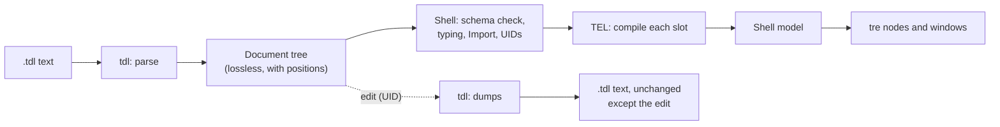

# TDL Library API

> Moved here from the Tesserae Shell design vault on 2026-11-02. This file is now the source of truth; the vault keeps a short pointer. Names of vault notes and decisions (D1 to D94, the ADR-0014 file layout and so on) refer to that vault and are not links.

> [!NOTE]
> The public Python API of the TDL library: repository and folder `tess-dl`, PyPI package `tesserae-dl`, import name `tdl` (ADR-0014 Shell File Language > Open Items, maintainer, 2026-11-02). The library reads TDL text into a tree that keeps everything in the file (comments, layout, positions), reports errors with `file:line:column`, and writes the text back unchanged except for a requested edit. It knows nothing about bars, monitors, tre, or the shell's keys. This note is a proposal for the maintainer, written so the `tess-dl` session can start from it. Names follow the Python standard library where a library does the same job (`json`, `tomllib`), because the maintainer asked that a person from another framework finds a familiar shape (ADR-0014 Shell File Language > Ninth-Round Decisions (2026-11-02) D68).

## Purpose and Scope

- Define the functions, classes, errors and guarantees that the shell, an editor tool and a test can rely on.
- Out of scope, by design: checking keys and types against a schema, typing a value (a length, a colour, a boolean), reading other files for `Import`, evaluating `{{ }}` slots (TEL does that), and talking to tre. All of those belong to the shell (Data Flow > Loading a Shell).
- The library takes text, not paths: file reading, `Import` and the config directory are the shell's (AGENTS > 3. Layering Principle, "Data in, not files").

## Where the Library Sits

The tree is not something tre can render. It describes the file. The shell turns it into its own model and only then into tre nodes (Layers and Components).

## Behaviour

### The Entry Points

| Function | Does | Familiar from |
|---|---|---|
| `tdl.loads(text, *, path=None, limits=None)` | Parses a string. Returns a `Document`. Raises `TDLError` on the first syntax error | `json.loads`, `tomllib.loads` |
| `tdl.load(fp, *, path=None, limits=None)` | Same, from a binary file object the caller opened (UTF-8; a byte-order mark is accepted). The library never opens a path itself | `tomllib.load` |
| `tdl.parse(text, *, path=None, limits=None)` | Parses and never raises for a syntax error. Returns a `ParseResult(document, errors)`: the best tree it could build (`None` when the metadata or root block cannot be read, a limit stops the file or the cap is reached) and every error found, in source order, up to `Limits.max_errors`. For editors and for the shell's "collect every error, then stop" rule | `ast.parse` (but tolerant) |
| `tdl.dumps(document)` | Returns the text of a document. For a document from `loads`, the result is exactly the input, byte for byte | `json.dumps` |
| `tdl.dump(document, fp)` | Writes that text to a binary file object | `json.dump` |

`path` is a label for error messages (`Top_Bar_Module.tdl`). It is never opened.

### Errors

One base class, `TDLError`, with a subclass `TDLSyntaxError`. Every error has:

| Field | Meaning |
|---|---|
| `code` | A stable slug such as `tdl-unclosed-block` ([TDL Language > Errors](language.md), D52) |
| `message` | One sentence saying what is wrong, in plain words |
| `hint` | What to write instead |
| `origin` | An `Origin`: `file`, `line`, `column` (both 1-based), and `end_line`, `end_column`, `offset` |
| `related` | Other `Origin`s the error mentions; a duplicate key names both places |

`str(error)` is `file:line:column: message (hint)`. The message follows the wording rules in [Wording and Familiar Names](#wording-and-familiar-names). The error list is the one in [TDL Language > Errors](language.md): the 17 accepted in D52, `tdl-unexpected-text` (G13) and four limit and input codes (`tdl-too-large`, `tdl-too-deep`, `tdl-unsupported-version`, `tdl-bad-encoding`, G18), all accepted by the maintainer on 2026-11-02, 22 in all.

> [!NOTE]
> **The suffix check is the shell's (maintainer, 2026-11-02, D91)**
> The library does not look at file names. Comparing the root block with the suffix (`_Shell.tdl`, `_Module.tdl`) is done by the shell, or by Tesserae UI for its own types, and the shell's error is `shell-root-suffix`. The library keeps 18 language errors and four limit and input codes (22 in all).

### Limits

`tdl.Limits(max_bytes=1_048_576, max_errors=50, max_depth=64)`. All three are decided: 1 MiB and 50 errors (Validation and Errors > Parsing) and depth 64, counting the root block as 1 (G11). A file over a limit stops with `tdl-too-large` or, for depth, `tdl-too-deep`. TEL uses a `Limits` class the same way.

### The Tree

All classes are importable from `tdl`. Nodes are immutable: they can be shared between threads, and an edit makes a new document.

| Class | Fields | Notes |
|---|---|---|
| `Document` | `metadata`, `root`, `path`, `text`, `language_version` | `text` is the source |
| `Metadata` | mapping from key to `Value`; `origin` | Keeps unknown keys. Reading is by key: `doc.metadata["Name"]` |
| `Block` | `type`, `entries`, `origin`, `name` | `type` is the word before the brace. `name` is the value of `Name:` or `None` |
| `Property` | `key`, `value`, `key_origin`, `value_origin` | `Key: value` |
| `If` | `condition: Slot`, `body`, `else_body` (or `None`), `origin` | `If {{ c }} { } Else { }` |
| `For` | `variable: str`, `items: Slot`, `key: Slot`, `body`, `name`, `origin` | `For x In {{ xs }} Key {{ x.id }} { }` |
| `Comment` | `text`, `origin` | A `#` comment, kept where it stands |

`Block.entries` holds `Property`, `Block`, `If`, `For` and `Comment` in source order. Helpers: `Block.properties` (a mapping by key; a repeated key is an error, D9), `Block.blocks` (child blocks only), `Block.get(key, default=None)`, `Block.walk()` (every descendant), and `Document.find("Shell_Root.Main.Top_Bar")` (a dotted path of `Name:` values, D28).

`Children` is an ordinary block named `Children`; `Import: file` is an ordinary property. `Document.imports()` lists the names so the shell does not search for them, and the library does not open them.

### Values

The library gives each value a lexical kind and the text it came from. It does not decide what the text means; that is the schema's job in the shell (a proposal, [Open Questions](#open-questions) 1).

| Class | Written as | Fields |
|---|---|---|
| `Word` | `TOP`, `true`, `Top_Bar`, `Battery` (unquoted) | `text`. Booleans, `null` and enums are words until the schema types them (D2, D33) |
| `String` | `"..."` or `'...'` | `value` (escapes resolved), `text` (as written) |
| `Number` | `16`, `-4`, `0.9` | `value` (`int` or `float`), `text` |
| `Percent` | `50%` | `value` (`int`), `text` |
| `Call` | `rgba(0 0 0 0.5)` | `name`, `args` (values separated by spaces) |
| `List` | `[a, b, c]` | `items` |
| `Slot` | `{{ expression }}` | `text` (what is between the braces), `text_origin` (where that text starts, for TEL), `origin` |
| `Template` | `Battery {{ battery.percent }}%` | `parts`: strings and `Slot`s, in order |

A value that is exactly one slot is a `Slot`; text with a slot inside is a `Template`, matching the rule in [TDL Language > Values](language.md).

`Slot.text_origin` is built to be handed to TEL. The library does not import TEL. The shell converts: `tel.Origin(file=o.file, line=o.line, column=o.column)`.

### Editing

A document never changes in place. An edit returns a new `Document` whose text equals the old text with one change.

| Call | Does |
|---|---|
| `document.with_metadata(key, value)` | Sets a metadata key. A new `UID` goes directly after the last version line (`TDL` or `Shell`, D10, G24); any other new key goes just before the closing `---`; an existing key changes only its value. `value` is plain text: a bare word when it reads back the same, else a quoted string (G32) |
| `document.without_metadata(key)` | Removes the whole line of a metadata key; unchanged if the key is absent |
| `block.with_property(key, value)` | Sets a property and returns the new `Document`. `value` is the TDL text of one value on one line. An existing property changes only its value; a new one goes on a line after the last property with that property's indentation and line ending, or inline in a block written on one line (G24, G32) |
| `document.replace(start, end, text)` | Replaces `document.text[start:end]` (character offsets) and reparses; the escape hatch |
| `document.find(path)` | The block at a dotted path of `Name:` values; the first name is the file's own `Name` and stands for the root block. Raises `KeyError` if there is none (D28, G32) |

Every edit keeps comments, blank lines, indentation and the order of everything it did not touch (this is what the UID write needs; R-06 in Risk Register). An edit that would make the file invalid raises `TDLError` and returns nothing. A call that is wrong whatever the file holds (a key that is not a name, a reserved word as a property key, a value that is not one value, a span outside the text, a block built in code) raises `ValueError`. Edits reread the result with the default `Limits`.

### Plain Data View

`document.to_data()` and `block.to_data()` return plain dicts, lists and strings, with no comments or positions, for tools and tests that only need the content. The shape is the library's first-slice decision. The tree is the main API; this is a convenience.

### Building a Tree in Code

The Python builder (Python Builder) must produce the same tree as the parser, so the nodes can be constructed directly: `Block("Bar", [Property("Edge", Word("TOP"))])`. A constructed node has no position. `tdl.dumps` formats a constructed tree with the library's standard layout (two-space indent). `node.canonical()` returns a normalised plain structure with trivia and positions dropped, so a parity test compares two trees by `==`. Names follow TEL's `canonical` (Expression Language Requirements > TEL 0.1.0 Released (2026-11-02)). Whether the formatter is in v0.1 is open.

### Wording and Familiar Names

The maintainer's rule (2026-11-02): the names and the prose are for people from the UI design world, who expect a thing to behave as it does in another framework. In this library that means:

- Function names come from `json` and `tomllib` (`loads`, `load`, `dumps`, `dump`), and node names from the file's own words (`Block`, `Property`, `Comment`), not from compiler jargon (`Token`, `Production`, `Lexeme` stay private).
- An error message says what happened in one plain sentence and the hint says what to write. It names the thing the author wrote, not the parser state: "This colour needs quotes. Write "#ffffff"." and not "unexpected token HASH".
- The language reference in `tess-dl` explains each construct with a short example before any rule, and says where TDL behaves differently from CSS, QML or Flutter (Familiar Names Audit when written).

## Configuration

None. The only inputs are the arguments above and the `Limits`.

## Python Contract

| Item | Value |
|---|---|
| Import | `import tdl`; every public name is in `tdl.__all__` |
| Version | `tdl.__version__` (package) and `tdl.LANGUAGE_VERSION` (`"0.1"`); a file with a newer major version raises `tdl-unsupported-version` |
| Python | 3.14 or later; no runtime dependencies (maintainer, 2026-11-02) |
| Typing | Fully typed; ships `py.typed` |
| Threads | Pure functions on immutable data: safe to call from any thread; the shell may parse on the watcher thread and hand the `Document` to the loop with `call_soon` (Process Model and Threading) |
| Stability | Before 1.0, a minor version may change the API; every change is listed in the changelog and in a `TDL-REQ-###` when the shell asks for it (AGENTS > 6. Requests Between Projects) |
| Private | Anything not in `__all__`, and the whole lexer |

## Integration

- The shell calls `tdl.parse` for every file at load, collects the errors, then walks the tree with its schema (Validation and Errors).
- The shell calls `document.with_metadata("UID", uuid)` and writes the result with its own file code when it registers a file (Config Discovery and Registry).
- TEL receives `slot.text` and an origin built from `slot.text_origin`; the shell adds nothing to the position because a slot sits on one line (Validation and Errors).
- A TextMate grammar and any later editor tool use `tdl.parse` and the codes.

## Design

None. This is a library without a user interface. The language it reads is designed in [TDL Language](language.md) and, after the move, in the `tess-dl` repository.

## Accessibility

Error messages are plain sentences that a screen reader reads whole: no colour or symbol carries meaning, and the position is in text (`file:line:column`).

## Performance Budget

- Parsing is one pass over the text and keeps no copy beyond the tree. Target: a 100 KB file in under 20 ms and a file at the 1 MiB limit in under 250 ms (proposed, to be measured on the first slice; Performance Budgets holds the ledger).
- `loads` of the same text twice gives equal documents; a cache is the shell's business (a warm cache keys on the file's hash, as the schema cache does).
- The library allocates no thread and no timer.

## Failure Modes and Recovery

| Failure | Result |
|---|---|
| Invalid UTF-8 in `load` | `TDLSyntaxError` `tdl-bad-encoding`, with the byte offset |
| Syntax error | `loads` raises at the first one it meets; `parse` records it and carries on (G31, [TDL Language > Errors](language.md)): a bad entry is skipped to the end of its line or the `}` that closes its block |
| More than 50 errors | The list stops at the limit, the last entry says `The list stops at 50 errors.`, and nothing more is read |
| An edit would break the file | `TDLError`; the original document is untouched |
| A newer language version | `tdl-unsupported-version`, with the library's version in the message |

## Open Questions

1. [x] **Values stay lexical** (maintainer, 2026-11-02, "yes", D74). The reasoning was: the library returns `Word`, `String`, `Number`, `Percent`, `Call`, `List`, `Slot` and `Template`, and the schema in the shell types them. The alternative is for the library to know lengths and colours, which makes it carry shell meaning.
2. [x] The suffix check is the shell's, as `shell-root-suffix` (maintainer, 2026-11-02, D91).
3. [ ] Whether the formatter and `canonical()` are in the first release or follow when the Python builder starts.
4. [ ] The shape of `to_data()`.
5. [x] The extra codes `tdl-unsupported-version`, `tdl-too-large`, `tdl-too-deep` and `tdl-bad-encoding` are accepted (maintainer, 2026-11-02, G18), with `tdl-unexpected-text` (G13).
6. [ ] A `tdl` command (`tdl check file.tdl`, `tdl format`) for authors and editors: recommended after the first release, not in it.
7. [ ] Build tooling and CI for `tess-dl` (the TEL project's choices are the starting point).

## Acceptance Criteria

- [ ] `tdl.dumps(tdl.loads(text)) == text` for every file in the conformance corpus (comments, blank lines, indentation, a final newline or none).
- [ ] The 22 error codes each have a corpus file that raises it with the stated `line` and `column`.
- [ ] `Width 32` raises `tdl-unexpected-text`, pointing at the first character that does not fit.
- [ ] `tdl.parse` on a file with six deliberate mistakes returns six errors with the right positions (JSON Schema and Editor Support).
- [ ] `with_metadata("UID", x)` puts `UID` directly after the last version field and changes no other byte.
- [ ] `Color: #fff` raises `tdl-bare-hash`; `Color: "#fff"   # note` is a `String` and a `Comment`.
- [ ] `Text: {{ max(a, b) }}` is one `Slot` with text ` max(a, b) `; `{{ '}}' }}` ends at the second `}}`; `{{ {'a': {'b': 1}} }}` ends at the first `}}` and leaves the rest to TEL.
- [ ] `}}` where two blocks close raises `tdl-double-close` and the hint says `} }`.
- [ ] A file at 1 MiB parses within the budget; one byte over raises `tdl-too-large`.
- [ ] Importing `tdl` imports no other third-party package, and `tdl.__all__` lists every public name.
- [ ] A tree built in code and the same file parsed give equal `canonical()` results.

## Links

- 42 Python API · ADR-0014 Shell File Language · [TDL Language](language.md) · Python Builder · Validation and Errors · Data Flow · Risk Register
